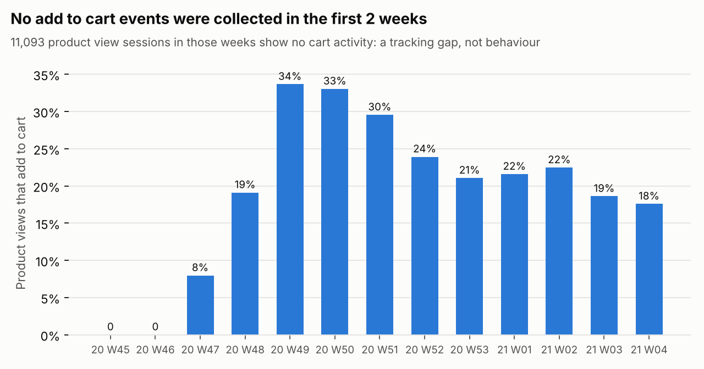
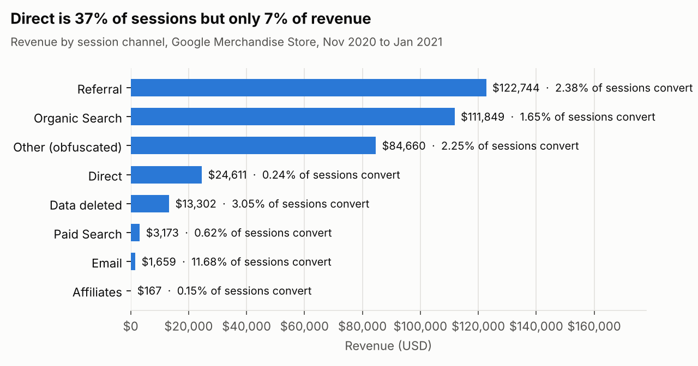
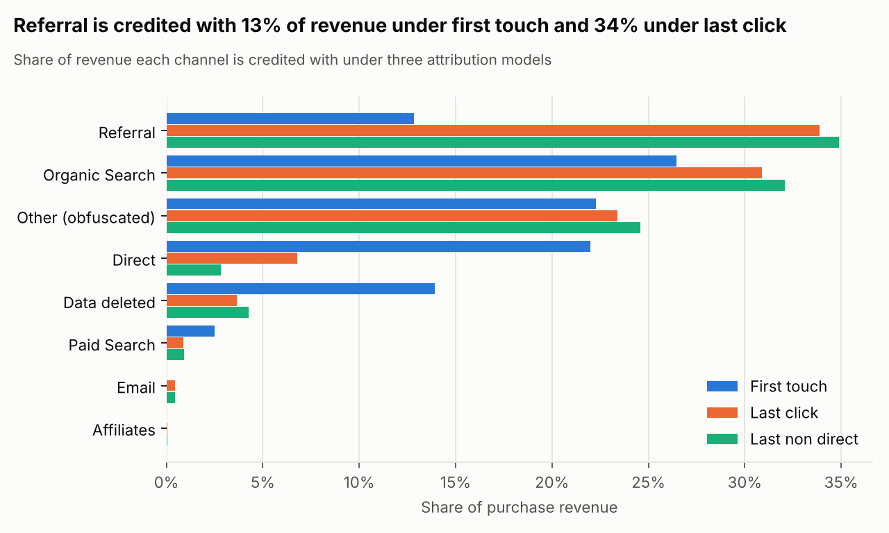
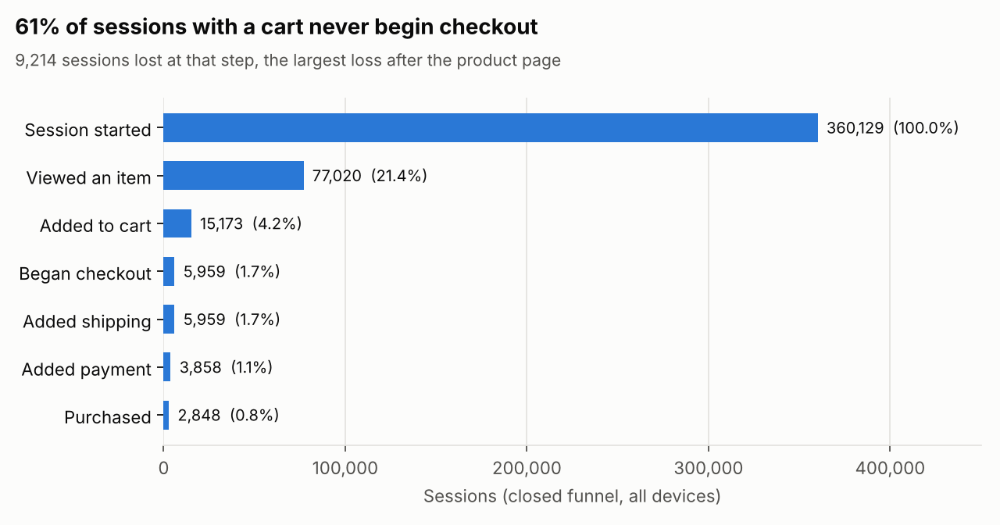
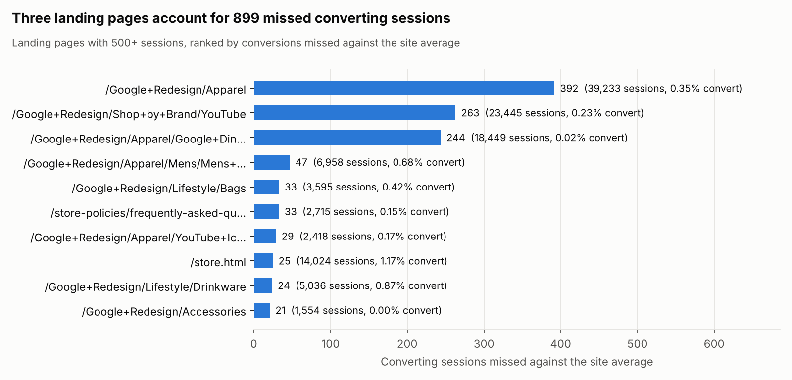

# GA4 Digital Insights: channels, funnel, attribution and testing

An end to end digital insights project on Google's public GA4 export for the Google Merchandise Store (1 November 2020 to 31 January 2021), queried in BigQuery. It answers the questions a digital marketing team asks every month, and includes the tracking plan and test plan that keep those answers trustworthy.

## The questions

| Question | Answered in |
| --- | --- |
| Which channels bring revenue, not just traffic? | [`sql/01_channel_performance.sql`](sql/01_channel_performance.sql) |
| Where do shoppers drop out of the purchase journey, and does it differ by device? | [`sql/02_funnel_dropoff.sql`](sql/02_funnel_dropoff.sql) |
| Which landing pages start good journeys, and which ones underperform the site? | [`sql/03_landing_pages.sql`](sql/03_landing_pages.sql) |
| How much does each channel's credit change between first touch and last click? | [`sql/04_attribution_first_vs_last.sql`](sql/04_attribution_first_vs_last.sql) |
| What should we test next, and how long would it take to prove? | [`sql/05_ab_test_baseline.sql`](sql/05_ab_test_baseline.sql), [`experimentation/`](experimentation/) |
| Can we trust the tracking these answers rely on? | [`tracking/`](tracking/), [`sql/06_utm_audit.sql`](sql/06_utm_audit.sql) |

## Findings

Three months, 360,129 sessions, 270,154 users and $362,165 of revenue. Every figure below comes from the CSVs in [`results/`](results/), and revenue and sessions reconcile across all seven queries.

### 1. The tracking has to be fixed before the channel numbers can be trusted

The most useful result was not a marketing insight. It was finding out which numbers a team should not act on yet.

| Issue found in the data | Evidence | Why it matters |
| --- | --- | --- |
| Self referrals | 57,596 of 64,490 Referral sessions (89%) come from the store's own domains | Referral looks like the top revenue channel (34%) when most of it is the site crediting itself |
| Add to cart tracking gap | No `add_to_cart` events in the first two weeks, across 11,093 product view sessions | The funnel understates product page performance: 19.7% across the sample, 24.9% once tracking is complete |
| Purchases without a distinct transaction ID | 5,692 purchase events against 4,451 distinct transaction IDs (22% missing or repeated) | Revenue may be double counted; GA4 can only deduplicate on the ID |
| Sessions with no page view | 26,446 sessions (7%) have no `page_view` and a 7% engagement rate | Inflates session counts and drags down every conversion rate |
| Two checkout steps firing together | `begin_checkout` and `add_shipping_info` appear in the same sessions (11,106 and 11,105) | The delivery step cannot be measured separately |
| Campaign tags breaking the naming standard | 5 source values in upper case, 1,525 sessions, including every email newsletter | Splits one campaign across several rows in reports |



### 2. Direct traffic is the largest channel and the weakest

Direct is 37% of sessions but 7% of revenue, converting 0.24% of sessions against 1.65% for Organic Search. Organic Search is the largest channel that can be trusted: 27% of sessions and 31% of revenue. Email converts best by far (11.7%, $8.42 a session) but on only 197 sessions, so it is a lead to test, not a conclusion. A further 27% of revenue sits in sources Google has masked in the public sample.



### 3. Attribution changes the story for Referral, Direct and Paid Search

| Channel | First touch | Last click | Last non direct |
| --- | --- | --- | --- |
| Referral | 13% | 34% | 35% |
| Organic Search | 26% | 31% | 32% |
| Direct | 22% | 7% | 3% |
| Paid Search | 2.5% | 0.9% | 0.9% |

Referral's share nearly triples between first touch and last click, which is the self referral problem again: customers arrive through another channel, the session restarts on the store's own domain, and the store takes the credit. Paid Search introduces $9,056 of revenue but closes only $3,173, so a last click report undervalues it almost three times over. A budget decision made on last click alone would cut the channel that is opening journeys.



### 4. The biggest loss after the product page is between cart and checkout

Of sessions that add to cart, 61% never begin checkout (9,214 sessions). After that, 35% drop at payment and 26% between payment and purchase. Device is not the cause: desktop, mobile and tablet convert within 0.05 percentage points of each other at every step (0.77%, 0.82% and 0.77% of sessions purchase).

Only 2,848 of the 4,848 purchasing sessions followed the whole funnel in one session. The other 41% bought from a cart built in an earlier visit, so a session funnel alone understates how well the store converts returning shoppers.



### 5. Three landing pages take 23% of sessions and almost no sales

The homepage starts 153,011 sessions, converts at 1.78% and carries 55% of revenue. The Apparel category page, the YouTube brand page and the Google Dino Game Tee product page start 81,127 sessions between them and convert 193. At the site average of 1.35% they would have converted about 899 more. The Dino Game Tee page alone has 18,449 landing sessions and 4 purchases, which points to traffic arriving with no buying intent, or a page that gives it nowhere to go.



### 6. The test that follows

Showing delivery cost and date in the cart, measured on the cart to checkout rate. Baseline 39%, 1,466 cart sessions a week: detecting a 10% relative lift needs 2,495 sessions per variant, so four full weeks. The rate swung between 24% and 47% across the holiday weeks, so the test should not straddle a seasonal peak. Full design in [`experimentation/ab_test_plan.md`](experimentation/ab_test_plan.md).

### What I would do first

1. Add the store's own domains to the unwanted referrals list and rerun the channel report. Until then, Referral and Direct cannot be judged.
2. Require a transaction ID on every purchase and reconcile GA4 revenue with the order system.
3. Fix campaign tag casing through the UTM builder, and run the audit query monthly.
4. Run the cart test for four weeks outside the holiday peak.
5. Investigate the three landing pages: where the traffic comes from, and what the page offers it.

## What's in the repo

```
sql/                  BigQuery queries on the GA4 export, one business question each
  00_dataset_profile.sql
  01_channel_performance.sql
  02_funnel_dropoff.sql
  03_landing_pages.sql
  04_attribution_first_vs_last.sql
  05_ab_test_baseline.sql
  06_utm_audit.sql
tracking/        How the data gets collected
  tracking_plan.md      GA4 and GTM setup, data layer specs, consent, QA checks, B2B lead handoff
  event_dictionary.csv  Every event, its trigger, parameters and whether it is a key event
  utm_naming_standard.md
experimentation/      How changes get tested
  ab_test_plan.md       Hypothesis, metrics, guardrails, decision rules, readout template
  sample_size.py        Sample size, test length, readout and sample ratio check
scripts/
  make_charts.py        Turns results/ into images/
results/              Query outputs as CSV
images/               Charts
docs/how_to_run.md    Step by step, free BigQuery sandbox
```

## How to run

Everything runs in the free BigQuery sandbox; no billing account is needed. The full steps are in [`docs/how_to_run.md`](docs/how_to_run.md):

1. Open BigQuery, paste each file from `sql/` and run it.
2. Save each result as a CSV in `results/` under the same name.
3. `pip install -r requirements.txt`, then `python scripts/make_charts.py`.
4. Size the test: `python experimentation/sample_size.py plan --baseline <rate> --mde 0.10 --weekly <sessions>`.

## Method notes

* **Session:** `user_pseudo_id` plus `ga_session_id`, the definition GA4 itself uses.
* **Session source and medium:** the first source and medium recorded in the session. GA4 stores them as event parameters; the user's first acquisition source sits in `traffic_source`.
* **Channels:** a simplified version of GA4's default channel group, in one SQL function shared by the channel and attribution queries.
* **Funnel:** closed, so a session counts at a step only if it reached every earlier step. Open funnel counts sit alongside for comparison.
* **Attribution:** first touch (the channel that acquired the user), last click (the purchase session's channel) and last non direct (the most recent non direct session up to the purchase, the logic behind GA4's paid and organic last click).
* **Obfuscation:** Google masks part of the sample, so some sources show as `<Other>` or `(data deleted)`. They are kept as their own rows rather than dropped, so totals still reconcile.
* **Revenue:** `ecommerce.purchase_revenue_in_usd`.

## Applying this to a B2B site

On a lead generation site the outcome happens in the CRM, not on the website. Section 6 of the [tracking plan](tracking/tracking_plan.md) carries the same approach through to qualified leads: one `generate_lead` key event, campaign source written into the CRM record with the lead, validation rules so the source can't go missing, and channel performance judged on qualified leads and revenue instead of form fills. The [test plan](experimentation/ab_test_plan.md) covers how testing changes when traffic is low.

## Tools

BigQuery SQL on the GA4 export schema (`UNNEST`, window functions, temporary functions) · Google Analytics 4 · Google Tag Manager · Python (pandas, SciPy, matplotlib)

## Data

[`bigquery-public-data.ga4_obfuscated_sample_ecommerce`](https://developers.google.com/analytics/bigquery/web-ecommerce-demo-dataset), published by Google through the BigQuery public datasets program.
